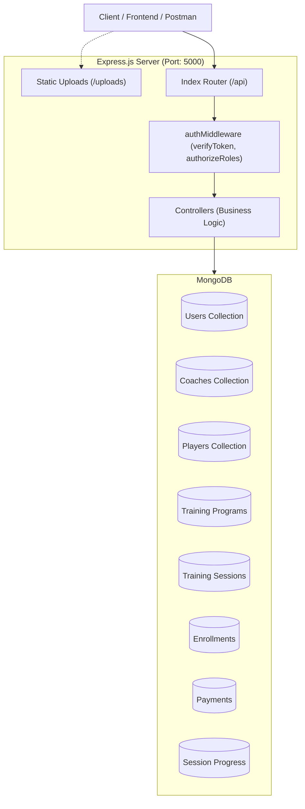

# 🏅 Sports Academy Management System API

[](https://nodejs.org/)
[](https://expressjs.com/)
[](https://mongoosejs.com/)
[](https://jwt.io/)
[](https://opensource.org/licenses/ISC)

A robust, scalable **RESTful Backend API** built with **Node.js, Express 5, MongoDB, and Mongoose** for managing sports academies, coaching programs, player enrollments, session tracking, and payments with strict **Role-Based Access Control (RBAC)**.

---

## 📑 Table of Contents

- [Overview](#-overview)
- [Key Features](#-key-features)
- [Tech Stack](#-tech-stack)
- [Project Architecture](#-project-architecture)
- [Folder Structure](#-folder-structure)
- [Role-Based Access Control (RBAC)](#-role-based-access-control-rbac)
- [Installation & Getting Started](#-installation--getting-started)
- [Environment Variables](#-environment-variables)
- [API Documentation](#-api-documentation)
  - [Authentication & Users](#1-authentication--users)
  - [Coach Module](#2-coach-module)
  - [Player Module](#3-player-module)
  - [Sports Categories](#4-sports-categories)
  - [Training Programs](#5-training-programs)
  - [Training Sessions](#6-training-sessions)
  - [Enrollments](#7-enrollments)
  - [Payments](#8-payments)
  - [Progress Tracking](#9-progress-tracking)
  - [File Uploads](#10-file-uploads)
- [Testing with Postman](#-testing-with-postman)
- [License](#-license)

---

## 🌟 Overview

The **Sports Academy Management System** serves as a complete digital backbone for sports academies, athletic institutions, and personal fitness trainers. It handles:

1. **User Authentication & Role Management**: Multi-tier access for Admins, Coaches, and Players.
2. **Coaching Profiles & Programs**: Coaches can design curriculum, schedule sequential sessions, and submit programs for review.
3. **Approval Lifecycle**: Admins audit and approve/reject training programs before they are published.
4. **Player Enrollment & Payments**: Seamless enrollment into free or paid programs with simulated payment flows.
5. **Interactive Progress Tracking**: Players track completed training sessions with milestone verification.

---

## 🚀 Key Features

- 🔐 **JWT-Based Authentication**: Secure stateless token authentication with password hashing using `bcrypt`.
- 👥 **Granular RBAC**: Dedicated middlewares verifying role privileges (`admin`, `coach`, `player`).
- 📁 **File Uploads with Multer**: Dedicated static routing for profile pictures and program banners.
- 🔄 **Program Workflow**: Draft $\rightarrow$ Pending $\rightarrow$ Approved / Rejected lifecycle.
- 📋 **Session Sequence & Reordering**: Arrange training sessions in logical order (`order` index).
- 💳 **Payment & Enrollment System**: Track payment transactions (`completed`, `pending`, `failed`) and link them to active enrollments.
- 📊 **Player Progress Tracking**: Unique index protection to track completion status per player per session.

---

## 🛠 Tech Stack

- **Runtime Environment**: [Node.js](https://nodejs.org/) (ES6+ / CommonJS)
- **Framework**: [Express.js v5](https://expressjs.com/)
- **Database**: [MongoDB](https://www.mongodb.com/)
- **ODM**: [Mongoose v9](https://mongoosejs.com/)
- **Authentication**: [jsonwebtoken (JWT)](https://github.com/auth0/node-jsonwebtoken) & [bcrypt](https://github.com/kelektiv/node.bcrypt.js)
- **File Handling**: [Multer](https://github.com/expressjs/multer)
- **Environment Management**: [dotenv](https://github.com/motdotla/dotenv)
- **Dev Tooling**: [Nodemon](https://nodemon.io/)

---

## 🏛 Project Architecture



---

## 📂 Folder Structure

```text
├── config/
│   └── db.js                        # MongoDB Mongoose connection setup
├── controller/
│   ├── authController/              # Login, register & auth profile controllers
│   ├── coach/                       # Coach profile & management
│   ├── enrollment/                  # Program enrollment logic
│   ├── payment/                     # Payment processing & history
│   ├── player/                      # Player profile management
│   ├── role/                        # Role management logic
│   ├── session/                     # Player session progress controllers
│   ├── sport/                       # Sports categories management
│   ├── training/                    # Program training sessions management
│   ├── trainingProgram/             # Program creation, approval, listing
│   └── user/                        # User administration controllers
├── middleware/
│   ├── authMiddleware.js            # JWT verification & RBAC authorization
│   └── uploadMiddleware.js          # Multer storage configuration for files
├── model/
│   ├── coach/coachModel.js          # Coach profile schema
│   ├── enrollment/enrollmentModel.js# Program enrollment schema
│   ├── payment/paymentModel.js      # Transaction schema
│   ├── player/playerModel.js        # Player profile schema
│   ├── role/roleModel.js            # Role definitions
│   ├── session/sessionModel.js      # Session progress schema
│   ├── sport/sportModel.js          # Sports category schema
│   ├── training/trainingModel.js    # Training session schema
│   ├── trainingProgram/trainingProgramModel.js # Training program schema
│   └── user/userModel.js            # User credentials & role schema
├── router/
│   ├── auth/authRouter.js           # /api/auth routes
│   ├── coach/coachRouter.js         # /api/coach routes
│   ├── enrollment/enrollmentRouter.js# /api/enrollments routes
│   ├── payment/paymentRouter.js     # /api/payments routes
│   ├── player/playerRouter.js       # /api/player routes
│   ├── role/roleRouter.js           # Role routes
│   ├── session/sessionRouter.js     # /api/progress routes
│   ├── sport/sportRouter.js         # /api/sports routes
│   ├── training/trainingRouter.js   # /api/sessions routes
│   ├── trainingProgram/trainingProgramRouter.js # /api/programs routes
│   ├── user/userRouter.js           # /api/users routes
│   └── indexRouter.js               # Central aggregator router
├── uploads/                         # Stored user profile images & banners
├── .env                             # Environment configuration
├── package.json                     # Project manifest & dependencies
└── server.js                        # Application entry point
```

---

## 🛡 Role-Based Access Control (RBAC)

| Role | Permissions & Scope |
| :--- | :--- |
| **`admin`** | Manage all users, change user status/role, approve/reject training programs, manage sports categories, view all system payment transactions. |
| **`coach`** | Build & update coach profile, create training programs, submit programs for admin approval, create & reorder training sessions, view enrolled players. |
| **`player`** | Build & update player profile, browse approved programs, join free programs, initiate and pay for programs, toggle session completion progress. |

---

## ⚡ Installation & Getting Started

### Prerequisites

- [Node.js](https://nodejs.org/) (v18.x or later recommended)
- [MongoDB](https://www.mongodb.com/) (running locally or MongoDB Atlas connection string)
- [Git](https://git-scm.com/)

### 1. Clone the repository
```bash
git clone https://github.com/your-username/sports-academy-api.git
cd sports-academy-api
```

### 2. Install dependencies
```bash
npm install
```

### 3. Setup Environment Variables
Create a `.env` file in the root directory:
```env
PORT=5000
MONGO_URL=mongodb://localhost:27017/sports_academy
JWT_SECRET=your_super_secret_jwt_key_here
```

### 4. Start the Server

- **Development Mode (with auto-reload):**
  ```bash
  npm run dev
  ```
- **Production Mode:**
  ```bash
  node server.js
  ```

Once started, the server runs at:
```
Server is running : http://localhost:5000
```

---

## 📖 API Documentation

All API endpoints are prefixed with `/api`.
Protected routes require the following authorization header:
```http
Authorization: Bearer <your_jwt_token>
```

---

### 1. Authentication & Users

#### 🔹 Register User
- **Method**: `POST`
- **Endpoint**: `/api/auth/register`
- **Access**: Public
- **Body**:
  ```json
  {
    "name": "John Doe",
    "email": "john@example.com",
    "password": "Password123",
    "role": "player" 
  }
  ```
  *(Roles available: `admin`, `coach`, `player`)*

#### 🔹 User Login
- **Method**: `POST`
- **Endpoint**: `/api/auth/login`
- **Access**: Public
- **Body**:
  ```json
  {
    "email": "john@example.com",
    "password": "Password123"
  }
  ```
- **Response**:
  ```json
  {
    "message": "Login successful",
    "token": "eyJhbGciOiJIUzI1NiIsInR5cCI6IkpXVCJ9...",
    "user": {
      "id": "60d0fe4f5311236168a109ca",
      "name": "John Doe",
      "email": "john@example.com",
      "role": "player"
    }
  }
  ```

#### 🔹 Get Current Profile
- **Method**: `GET`
- **Endpoint**: `/api/auth/me`
- **Access**: Authenticated (`admin`, `coach`, `player`)

#### 🔹 Admin: Get All Users
- **Method**: `GET`
- **Endpoint**: `/api/users`
- **Access**: `admin`

#### 🔹 Admin: Update User Status
- **Method**: `PUT`
- **Endpoint**: `/api/users/:userId/status`
- **Access**: `admin`
- **Body**:
  ```json
  {
    "status": "active"
  }
  ```

#### 🔹 Admin: Update User Role
- **Method**: `PUT`
- **Endpoint**: `/api/users/:userId/role`
- **Access**: `admin`
- **Body**:
  ```json
  {
    "role": "coach"
  }
  ```

---

### 2. Coach Module

#### 🔹 Create / Update Coach Profile
- **Method**: `POST`
- **Endpoint**: `/api/coach/profile`
- **Access**: `coach`
- **Content-Type**: `multipart/form-data`
- **Fields**:
  - `specialization`: `"Football / Tactical Drills"`
  - `qualification`: `"UEFA B License"`
  - `experience`: `5`
  - `bio`: `"Experienced coach with 5+ years training youths."`
  - `profileimage`: *(File attachment)*

#### 🔹 Get My Coach Profile
- **Method**: `GET`
- **Endpoint**: `/api/coach/profile/me`
- **Access**: `coach`

#### 🔹 View Any Coach Profile
- **Method**: `GET`
- **Endpoint**: `/api/coach/profile/:coachId`
- **Access**: Authenticated

---

### 3. Player Module

#### 🔹 Create / Update Player Profile
- **Method**: `POST`
- **Endpoint**: `/api/player/profile`
- **Access**: `player`
- **Content-Type**: `multipart/form-data`
- **Fields**:
  - `age`: `19`
  - `preferredSport`: `"<sport_object_id>"`
  - `fitnessLevel`: `"Intermediate"`
  - `profileimage`: *(File attachment)*

#### 🔹 Get My Player Profile
- **Method**: `GET`
- **Endpoint**: `/api/player/profile/me`
- **Access**: `player`

---

### 4. Sports Categories

#### 🔹 Get All Sports
- **Method**: `GET`
- **Endpoint**: `/api/sports`
- **Access**: Public / Authenticated

#### 🔹 Create Sport Category
- **Method**: `POST`
- **Endpoint**: `/api/sports`
- **Access**: `admin`
- **Body**:
  ```json
  {
    "name": "Cricket",
    "description": "Outdoor bat-and-ball game."
  }
  ```

#### 🔹 Delete Sport Category
- **Method**: `DELETE`
- **Endpoint**: `/api/sports/:sportId`
- **Access**: `admin`

---

### 5. Training Programs

#### 🔹 Browse Approved Programs
- **Method**: `GET`
- **Endpoint**: `/api/programs/approved`
- **Access**: Authenticated

#### 🔹 Create Program (Draft)
- **Method**: `POST`
- **Endpoint**: `/api/programs/create`
- **Access**: `coach`
- **Content-Type**: `multipart/form-data`
- **Fields**:
  - `sportId`: `"<sport_object_id>"`
  - `name`: `"Speed & Agility Masterclass"`
  - `description`: `"Intensive 4-week athletic drill program."`
  - `difficultyLevel`: `"Beginner"` *(Beginner | Intermediate | Advanced)*
  - `duration`: `"4 Weeks"`
  - `requirements`: `"Proper running shoes"`
  - `learningOutcomes`: `"Sprint acceleration and stamina"`
  - `fee`: `1200` *(0 for free program)*
  - `image`: *(File attachment)*

#### 🔹 Submit Program for Approval
- **Method**: `PUT`
- **Endpoint**: `/api/programs/:programId/submit`
- **Access**: `coach`

#### 🔹 Admin Review Program
- **Method**: `PUT`
- **Endpoint**: `/api/programs/:programId/review`
- **Access**: `admin`
- **Body**:
  ```json
  {
    "approvalStatus": "approved",
    "rejectionReason": ""
  }
  ```

---

### 6. Training Sessions

#### 🔹 Get Program Sessions
- **Method**: `GET`
- **Endpoint**: `/api/sessions/program/:programId`
- **Access**: Authenticated

#### 🔹 Add Session to Program
- **Method**: `POST`
- **Endpoint**: `/api/sessions/session`
- **Access**: `coach`
- **Body**:
  ```json
  {
    "programId": "651a1b...",
    "title": "Warm-up & Footwork Drills",
    "description": "Focus on high-knees and cone agility.",
    "duration": "45 mins",
    "order": 1
  }
  ```

#### 🔹 Reorder Sessions
- **Method**: `PUT`
- **Endpoint**: `/api/sessions/session/reorder`
- **Access**: `coach`
- **Body**:
  ```json
  {
    "programId": "651a1b...",
    "orderedSessionIds": [
      "651a2c...",
      "651a2d...",
      "651a2e..."
    ]
  }
  ```

---

### 7. Enrollments

#### 🔹 Join Free Program
- **Method**: `POST`
- **Endpoint**: `/api/enrollments/free`
- **Access**: `player`
- **Body**:
  ```json
  {
    "programId": "651a1b..."
  }
  ```

#### 🔹 Initiate Paid Program Enrollment
- **Method**: `POST`
- **Endpoint**: `/api/enrollments/initiate-paid`
- **Access**: `player`
- **Body**:
  ```json
  {
    "programId": "651a1b..."
  }
  ```

#### 🔹 View My Enrollments
- **Method**: `GET`
- **Endpoint**: `/api/enrollments/my/all`
- **Access**: `player`

#### 🔹 Coach: View Enrolled Players
- **Method**: `GET`
- **Endpoint**: `/api/enrollments/program/:programId/players`
- **Access**: `coach`

---

### 8. Payments

#### 🔹 Process Payment
- **Method**: `POST`
- **Endpoint**: `/api/payments/process`
- **Access**: `player`
- **Body**:
  ```json
  {
    "enrollmentId": "651a3f...",
    "amount": 1200,
    "paymentGateway": "MockGateway"
  }
  ```

#### 🔹 View Payment History
- **Method**: `GET`
- **Endpoint**: `/api/payments/history`
- **Access**: `player`

#### 🔹 Admin: View All Transactions
- **Method**: `GET`
- **Endpoint**: `/api/payments/admin/all`
- **Access**: `admin`

---

### 9. Progress Tracking

#### 🔹 Toggle Session Progress (Mark Done / Undone)
- **Method**: `POST`
- **Endpoint**: `/api/progress/toggle`
- **Access**: `player`
- **Body**:
  ```json
  {
    "programId": "651a1b...",
    "sessionId": "651a2c..."
  }
  ```

#### 🔹 View Program Progress
- **Method**: `GET`
- **Endpoint**: `/api/progress/program/:programId`
- **Access**: `player`

---

### 10. File Uploads

#### 🔹 Upload Single Media File
- **Method**: `POST`
- **Endpoint**: `/api/upload`
- **Access**: Public / Authenticated
- **Content-Type**: `multipart/form-data`
- **Form Field**: `file`
- **Response**:
  ```json
  {
    "message": "File uploaded successfully.",
    "fileUrl": "/uploads/1729000000000-filename.png",
    "filename": "1729000000000-filename.png"
  }
  ```

---

## 🧪 Testing with Postman

1. Import the endpoints into [Postman](https://www.postman.com/) or your preferred API client.
2. Hit `POST /api/auth/register` to create accounts for `admin`, `coach`, and `player`.
3. Hit `POST /api/auth/login` to obtain the JWT Token.
4. Set the `Authorization` header type to **Bearer Token** in subsequent requests.
5. For file upload endpoints (`/api/upload`, `/api/coach/profile`, `/api/programs/create`), set the request body to `form-data`.

---

## 📄 License

This project is licensed under the **ISC License**. Feel free to use and modify it for educational or commercial purposes.
